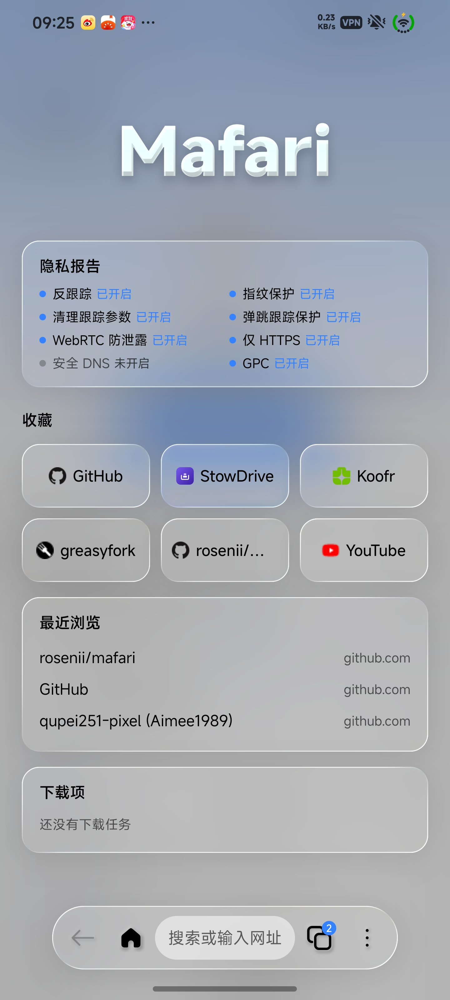
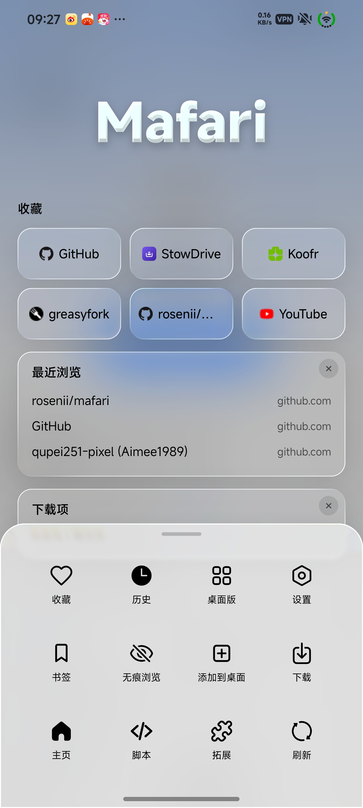
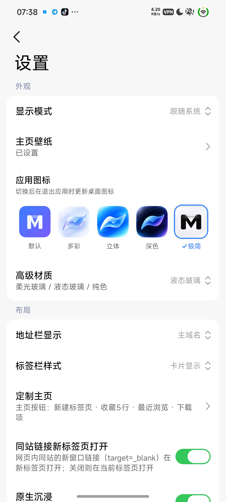

<div align="center">

# Mafari

**一款好看、好用、能装扩展的 Android 浏览器**

**简体中文** · [English](README_EN.md) · [☕ 捐赠](#捐赠)

📢 [Telegram 频道](https://t.me/mafari_a) · 💬 [Telegram 交流群](https://t.me/Mafari_discuss) · 📦 [下载](https://github.com/rosenii/mafari/releases)

**源码可见项目**
</div>

---

Mafari 是一款基于 **miuix** 设计风格的 Android 浏览器：界面简洁、动效细腻，同时没有牺牲功能——油猴脚本、广告拦截、阅读模式、密码管理、加密备份都已内置，系统 WebView 内核也能安装并运行浏览器拓展（实验性）。

提供 **lite、sync_lite、gecko** 三个版本：想要轻巧，选 lite；想要轻巧又要跨设备同步，选 sync_lite；想要 Firefox 内核、原生 Firefox 扩展（包括 **Floccus 书签同步**），选 gecko。三个版本的 WebView 内核都可以安装拓展（实验性，见下文）。

免费、无广告，由个人开发者维护。

<div align="center">

| 主页 | 更多面板 | 设置 |
| --- | --- | --- |
|  |  |  |

</div>

## 三个版本，怎么选？

| | **lite** | **sync_lite** | **gecko** |
| --- | --- | --- | --- |
| 一句话 | 轻巧省心 | lite + Firefox 同步 | 双内核，功能最全 |
| 渲染引擎 | 系统 WebView | 系统 WebView | 系统 WebView + Firefox 内核（GeckoView），可切换 |
| 安装包体积 | 小 | 小 | 较大 |
| 适用设备 | arm64-v8a / armeabi-v7a / x86_64 | 仅 arm64 | 仅 arm64 |
| 油猴脚本 | ✅ | ✅ | ✅ |
| WebView 拓展（实验性） | ✅ | ✅ | ✅（WebView 标签） |
| Firefox 扩展（Gecko 原生） | — | — | ✅ |
| Floccus 书签同步 | — | — | ✅ |
| Firefox 帐户同步 | — | ✅ | ✅ |
| 广告拦截 | 内置规则引擎 | 内置规则引擎 | WebView 标签用内置规则；Gecko 标签用跟踪保护或 uBlock Origin |
| WebDAV / Git 加密备份 | ✅ | ✅ | ✅ |

三个版本使用同一个应用 ID，可以互相覆盖升级，数据不丢。

### lite：轻巧省心

不内嵌任何浏览器内核，直接使用系统 WebView，安装包小，网页兼容性与系统 WebView 保持一致，几乎所有设备都能装。

- **广告拦截**：支持 Adblock Plus、uBlock、AdGuard、hosts 等常见订阅格式，可从链接或文件导入，并按天 / 3 天 / 每周自动更新；支持自定义规则与站点白名单，长按网页元素即可「标记为广告」。
- **指纹保护**：Canvas、WebGL、音频、字体四项可单独开关，让网站难以通过设备特征识别你，详见 [docs/FINGERPRINT.md](docs/FINGERPRINT.md)。
- 网页权限管理、HTTP / SOCKS5 代理（支持认证）、Passkey 一应俱全。

### sync_lite：轻巧，并且能同步

在 lite 的基础上加入 **Firefox 帐户同步**，登录同一个 Firefox 帐户，就能和电脑、其他手机上的 Firefox 互通：

- 同步**书签、历史记录、标签页和密码**，使用 Firefox 官方 Sync 协议，帐户数据端到端加密。
- 可以把当前网页**发送到其他设备**，也能收到其他设备发来的标签页。
- 密码双向同步（含修改与删除）；书签和历史目前只增不删，Firefox 的书签会放进独立分组，本地书签会推送到「移动设备书签」。

> 仅提供 arm64 版本。已安装 sync_lite 的用户，检查更新时会自动升级到 sync_lite 的新版本。

### gecko：功能最全的双内核版

在 lite 的基础上内嵌 **GeckoView（Firefox Nightly）**，可以在 **设置 → 高级 → 浏览器内核** 里切换 WebView / Gecko。内核按标签页确定，切换后只影响之后新建的标签；设备不支持或 Gecko 启动失败时，会自动退回 WebView。同时包含 Firefox 帐户同步。

**Firefox 扩展**
在应用内直接搜索并安装 Firefox 扩展商店（AMO）上的扩展，也可以导入本地 `.xpi`；支持启用 / 停用、选项页、自动检查更新，每次安装和授权都有中文确认框。

**Floccus：跨浏览器书签同步**
[Floccus](https://floccus.org) 是一款开源的书签同步扩展，可以通过 Nextcloud、WebDAV、Git 等方式，让不同浏览器、不同设备的书签保持一致。Mafari 对它做了专门适配：

- 在扩展页安装 Floccus 时，Mafari 会自动完成适配，装好即可使用，无需额外设置。
- Floccus 同步的就是 Mafari 自己的书签：在手机上整理的书签会同步到电脑，电脑上新增的书签也会出现在 Mafari 里。
- 检查更新时，Mafari 会从 GitHub 获取 Floccus 的最新正式版，并自动重新适配后覆盖安装。

> 适配后的 Floccus 没有 Mozilla 签名，需要内核允许未签名扩展（Nightly 默认允许），Mafari 安装时会自动处理。

**高级隐私保护**
增强型跟踪保护（关闭 / 标准 / 严格）、清理网址跟踪参数、弹跳跟踪保护、定期清理跟踪者数据、强力抗指纹、GPC / DNT、精简 Referer、防 WebRTC 泄露 IP、严格第一方隔离、仅 HTTPS、安全 DNS（DoH）、ECH 等，可一键恢复默认。

**其他**
- 油猴脚本在 Gecko 下同样可用，与 WebView 共用同一批脚本和数据，并对脚本的网络、Cookie、通知等能力做了严格限制，详见 [docs/GECKO_GM.md](docs/GECKO_GM.md)。
- Gecko 的默认字体可以跟随系统（含厂商主题字体）。
- 内置 USB 远程调试、`about:config`、运行日志，方便高阶用户排查问题。

> Gecko 标签下，内置广告规则与「标记为广告」不适用，请安装 uBlock Origin，或使用内置的跟踪保护；网站权限由 Gecko 自身管理。适配矩阵见 [docs/GECKO.md](docs/GECKO.md)。

## 三个版本都有的功能

**界面与浏览**
- 网页态顶部状态栏使用与子页面顶栏同款的 **miuix 渐进模糊**（自上而下由强到弱，取网页顶部边缘色拉伸采样）：页面处于初始状态时显示，下滑沉浸后淡出；悬浮默认栏、悬浮三段式、固定在底部的栏都适用。
- 悬浮三段式识别到网页自带底栏 / 输入框（聊天输入框、评论框、结算栏等）时，会沉到屏幕底部让出一行；这一行的背景同样是渐进模糊（贴底最强、向上渐隐），取网页底部边缘色拉伸采样。
- 单条悬浮底栏，「高级材质」可选柔光玻璃（带折射与边缘高光）、磨砂（无折射，更稳更省）、液态玻璃或纯色；向下滚动时自动让出空间，回到顶部再恢复；底栏可左右滑动缩成圆形搜索钮，导航栏样式可选「靠上 / 靠下 / 始终最小化 / 固定 / 悬浮三段式」。
- 多标签，可在文字列表与卡片两种样式间切换；地址栏可显示网站标题、主域名或完整域名。
- 主页内容（收藏、书签分组、隐私报告、最近浏览、下载项）可显示 / 隐藏并拖动排序；起始页可设为默认主页、新标签页或指定网页。
- 点击主页的书签分组，会在图标下方弹出小窗，直接浏览子分组与书签，不用跳转页面。
- 下拉刷新、页内查找、翻译、分享、长按链接菜单等常用功能一应俱全。
- 输入网址时，地址栏最左侧显示当前搜索引擎图标，点一下即可快速切换；引擎列表末尾可添加自定义引擎（网址里用 `%s` 代表关键词），自定义引擎可删除。
- 「添加到桌面」把网页做成桌面图标，打开后是没有底栏的独立窗口（轻应用）；Gecko 标签页带 Web App Manifest（PWA）时，名称、图标、范围和主题色取自 manifest。「扫一扫」可识别二维码 / 条码（内置识别，不依赖 Google Play 服务）。
- 主页可设置壁纸（可选模糊）；桌面图标有 6 种可选。
- 无痕标签使用独立的 WebView Profile：Cookie、缓存、本地存储和网站权限都与普通标签隔离，关闭后整个 Profile 一并删除。

**外部链接与默认浏览器**
- 可设为系统默认浏览器：首次启动会询问，也可以在 **设置 → 设为默认浏览器** 里随时设置。
- **设置 → 外部链接打开方式** 三选一：
  - **应用内打开**：进入 Mafari 主界面。
  - **自定义标签页**：在调用方应用上层打开轻量网页窗口，返回即回到原应用，也可以一键转到 Mafari 里打开。Mafari 同时提供 Custom Tabs 服务，使用 Custom Tabs 的应用会把它识别为支持自定义标签页的浏览器。
  - **其他浏览器**：弹出选择器，并排除 Mafari 自己。
- 桌面快捷方式固定在应用内打开，不受这项设置影响。

**WebView 拓展（实验性）**
系统 WebView 内核也能装拓展：Mafari 自研了一层 WebExtensions 适配器，把 `browser.*` / `chrome.*` 接口接到 WebView 上，MV2 / MV3 拓展都可以尝试。lite、sync_lite 和 gecko 的 WebView 标签均可使用，Gecko 标签仍走 Firefox 原生扩展。

- **安装与管理**：在 **设置 → 拓展** 里搜索 Firefox 拓展商店（AMO），或导入拓展商店页面链接、`.zip` / `.crx` / `.xpi` 直链、本地拓展包；安装和授权前有中文权限确认框，支持启用 / 停用、卸载、选项页和自动检查更新。「网页增强」总开关可一键停用全部油猴脚本、去广告和拓展，关闭后冷启动也不再加载。
- **快捷菜单**：底栏「更多」→「拓展」打开运行列表，可单独启停；声明了 popup 的拓展点一下就在面板内打开，长按进入拓展管理页。
- **隔离与安全**：每个拓展使用独立的 WebView Profile，存储与标签页、其他拓展互不可见；系统 WebView 支持时，content script 运行在各自独立的隔离世界里。无痕标签不运行拓展。
- **冷启动不拖慢**：拓展在首页加载完成后才晚加载，后台页错开拉起，不影响第一屏。
- **已适配的接口**（均有权限校验，未实现的接口明确返回 `UNSUPPORTED`，不会假装成功）：`runtime` 消息 / Port / `getContexts`、`storage`、`alarms`、`permissions`、`tabs`、`scripting` 与动态 content script、`webNavigation`、`webRequest`（含 `onBeforeRequest` 的取消 / 重定向）、`declarativeNetRequest` 动态规则、`userScripts`、`bookmarks`、`cookies`、`downloads`、`history`、`contextMenus`、`notifications`、`action` / `browserAction`、`offscreen`、`i18n`；另有 Mafari 专有的 `clipboard` 与 `mafari.userscripts` 接口。
- **已知限制**：单窗口；`scripting` / `webNavigation` 目前只支持主框架；MV3 Service Worker 是隐藏页面模拟，没有真正的休眠 / 唤醒；`storage.sync` 只是本地存储，不跨设备同步；请求头改写等 `webRequest` 能力受 WebView 限制。

> 应用已原生支持油猴脚本，请不要再安装 Tampermonkey 等油猴类拓展。详细进度与限制见 [docs/WEBEXT_WEBVIEW.md](docs/WEBEXT_WEBVIEW.md)、[docs/MAFARI_WEBEXT_API.md](docs/MAFARI_WEBEXT_API.md) 和 [兼容性矩阵](WEBEXT_API_COMPATIBILITY_MATRIX_UPDATED.md)。

**阅读模式**
遇到文章类页面，地址栏左侧会出现阅读图标。点一下，页面只留下标题、作者、正文和图片，并跟随应用深浅色；再点一下或按返回键即可回到原页面和原来的位置。

**下载管理**
内置下载器，支持多线程分段下载、断点续传、暂停 / 继续与失败重试，进度显示在通知栏；小米设备上还会接入**超级岛**。文件统一保存在 `Download/mafari`。

**油猴脚本**
支持 `GM_*` 接口、脚本菜单命令、从链接或文件导入；打开 `.user.js` 链接时自动弹出安装确认，可手动或定期更新。

**密码管理与自动填充**
- 登录后询问是否保存或更新密码，下次点登录框即可选择账号填入，填充前可要求验证身份。
- 可作为系统自动填充服务使用，在 WebView 和 Gecko 网页里都能用 Mafari 的密码库填充。
- 支持 CSV 导入导出。

**备份**
- 备份内容可自选，用口令加密后保存为本地文件，或推送到 **WebDAV / Git 仓库**，并可按间隔自动备份。
- 恢复时可以逐项勾选要还原的内容，换机无忧。
- 备份文件由口令保护（Argon2id 派生密钥），采用后量子混合加密（ML-KEM + X25519 + AES-256-GCM）；本机数据同样加密保存：历史记录库使用 SQLCipher（AES-256 整库加密），书签、密码等逐条加密。

## 下载与安装

前往 [Releases](https://github.com/rosenii/mafari/releases) 下载，要求 **Android 13 及以上**。

| 安装包 | 对应版本 |
| --- | --- |
| `Mafari-<版本>-lite-<架构>.apk` | **lite**，按手机架构选择（arm64-v8a / armeabi-v7a / x86_64），不确定就选 arm64-v8a |
| `Mafari-<版本>-sync_lite-arm64.apk` | **sync_lite**，仅 arm64 |
| `Mafari-<版本>-gecko.apk` | **gecko**，仅 arm64 |

应用内「关于 → 版本」可以选择**更新通道**，检查更新时会自动匹配对应的安装包。Releases 附带 `SHA256SUMS.txt`；应用内更新下载完成后会校验 SHA-256，能取到官方摘要时对不上就会丢弃安装包。

## 社区

- 📢 更新频道：<https://t.me/mafari_a>
- 💬 交流群组：<https://t.me/Mafari_discuss>

遇到问题或有建议，欢迎到群里聊聊，或者在 GitHub 提 Issue。

## 想自己构建？

需要 JDK 21+、Android SDK 和 git。miuix 不随仓库提供，要先拉取上游并打上本地补丁，再构建（以 lite 为例）：

```bash
bash tools/miuix-sync.sh   # 拉取 miuix 到 third_party/miuix 并应用 tools/miuix-patches（版本见 miuix.ref）
./gradlew :app:assembleLiteArm64Debug
```

默认跟随 miuix 主线；需要固定版本时，在 `miuix.ref` 里填 `commit=`（或运行 `bash tools/miuix-sync.sh --pin` 写入当前提交）。

完整的构建说明、版本变体、自动发布流程与代码结构，请见 [docs/ARCHITECTURE.md](docs/ARCHITECTURE.md)。


## 捐赠

Mafari 由个人业余时间开发维护，完全免费、无广告。如果它对你有帮助，欢迎请开发者喝杯咖啡 ☕，这会让项目走得更久。

<div align="center">


微信「扫一扫」扫码赞赏（应用内路径：设置 / 关于 → 捐赠，可一键保存赞赏码）

</div>

点个 ⭐ Star、反馈问题、推荐给朋友，同样是很大的支持。

## 多语言 / Localization

设置 → 外观 → 第一行「语言」：跟随系统 / English / 简体中文 / 繁體中文（切换后自动重启生效）；引导页第一屏也可以选择语言。

- 源码中的界面文案以简体中文为键：`tr("设置")`；带变量用 `{0}` `{1}`：`tr("共 {0} 项", n)`（`i18n/I18n.kt`）。
- English：`app/src/main/assets/i18n/en.tsv`（`中文原文<TAB>English`，`\n` `\t` `\\` 为转义）。
- 繁體中文：`zh-TW-phrases.tsv`（台湾用语）+ `s2t.txt`（简→繁逐字表）运行时转换；个别用词不理想时在 phrases 里加一行即可。
- 找不到译文时回退为简体中文原文，不会崩溃。新增文案只需在代码里写 `tr("…")`，再往 en.tsv 补一行。
- 系统级字符串（应用名、自动填充服务名）在 `res/values*/strings.xml`，跟随系统语言。

## WebExtension 适配器文档

WebView 拓展适配器（实验性）的说明见 [`docs/WEBEXT_WEBVIEW.md`](docs/WEBEXT_WEBVIEW.md)。Mafari 专有接口（剪贴板、原生油猴桥、部分 `webRequestBlocking`）见 [`docs/WEBEXT_MAFARI_APIS.md`](docs/WEBEXT_MAFARI_APIS.md) 和 [`docs/MAFARI_WEBEXT_API.md`](docs/MAFARI_WEBEXT_API.md)；动态 DNR 规则与 `userScripts` 子集见 [`docs/WEBEXT_DNR_USERSCRIPTS.md`](docs/WEBEXT_DNR_USERSCRIPTS.md)；兼容性矩阵见 [`WEBEXT_API_COMPATIBILITY_MATRIX_UPDATED.md`](WEBEXT_API_COMPATIBILITY_MATRIX_UPDATED.md)。
