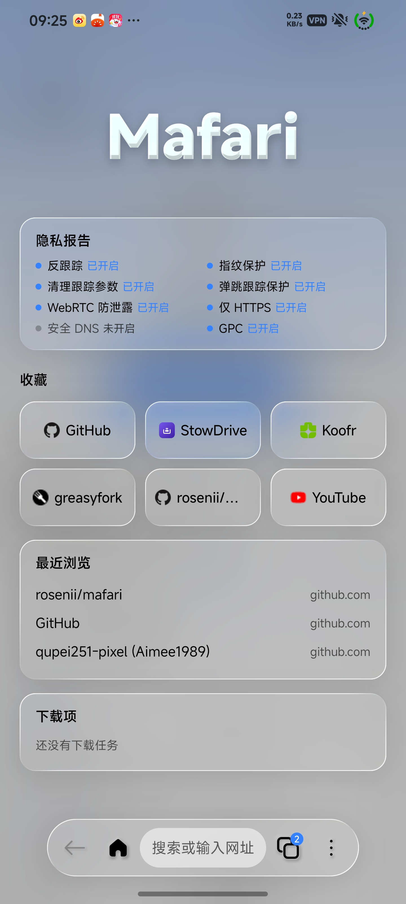
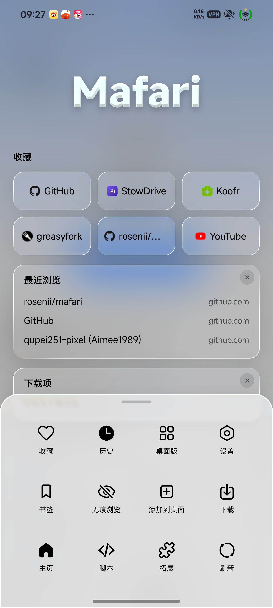
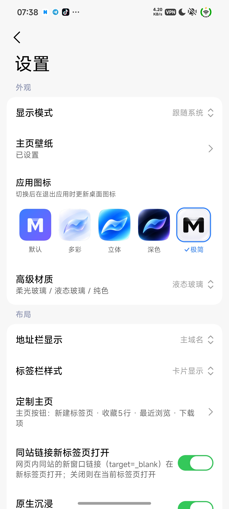

<div align="center">

# Mafari

**简体中文** · [English](#english)

📢 [Telegram 频道 / Channel](https://t.me/mafari_a) · 💬 [Telegram 交流群 / Discussion](https://t.me/Mafari_discuss) · 📦 [Releases](https://github.com/rosenii/mafari/releases)

</div>

---

# 简体中文

基于 **miuix**（Compose Multiplatform）的 Android 浏览器，提供两个版本：

| | 无内核版 | Gecko 版 |
| --- | --- | --- |
| 渲染内核 | 系统 WebView，**不内嵌任何浏览器内核**，安装包小 | 内嵌 **GeckoView（Nightly）**，并保留系统 WebView，支持双内核切换 |
| 设备要求 | 所有支持的 Android 设备 | 内核仅 arm64-v8a；其它架构自动使用 WebView |
| 增强 | 油猴脚本 | 油猴脚本 + Firefox 扩展（AMO / `.xpi`） |
| 去广告 | 内置规则引擎 | WebView 标签可用；Gecko 标签使用内置跟踪保护或自行安装 uBlock Origin |
| 发布 | 打 tag 自动发布正式版 | `gecko` 分支每次构建发布预发布版 |

## 社区

- 📢 更新频道：<https://t.me/mafari_a>
- 💬 交流群组：<https://t.me/Mafari_discuss>

## 界面

| 主页 | 更多面板 | 设置 |
| --- | --- | --- |
|  |  |  |

- 单条简约悬浮底栏：支持柔光玻璃 / 液态玻璃效果
- 全屏沉浸浏览：状态栏初始占位留白，向下滚动顶满，回顶回落，既不影响网页顶部元素点击，也能沉浸浏览
- 底栏手势：网页向下累计约 100px 才隐藏，隐藏后须向上累计约 120px 才恢复；底栏上**左右滑动**缩小为圆形搜索钮，点按或再滑展开；长按地址栏复制网址

## 两个版本共有的功能

**浏览**
- 多标签（文字列表 / 卡片两种样式）、前进后退刷新、加载进度；地址栏可显示网站标题 / 主域名 / 完整域名
- 下拉刷新、页内查找、翻译、分享、复制链接、外部浏览器打开、长按链接菜单
- **定制主页**：主页内容（收藏 1~5 行、隐私报告、最近浏览、下载项）可显示 / 隐藏并拖动排序；**自定义主页**可选「默认主页 / 新建标签页 / 指定页面」，决定点击主页按钮、启动应用、新建标签页时打开什么
- 收藏 / 历史 / 下载管理 / 脚本管理；设置里可调显示模式、壁纸、模糊效果、搜索引擎、自定义 UA、代理、检查更新

**下载**
- 内置下载器（不走系统下载器），先写缓存再入库到 `/sdcard/Download/mafari`
- 多线程分段下载（服务器支持 Range 时）、断点续传、暂停 / 继续、失败重试
- 前台服务 + 进度通知；按小米官方文档接入**超级岛**（`miui.focus.param`，仅在开始下载时上岛）

**脚本（油猴）**
- 内置油猴脚本运行时，支持 `GM_*` API、脚本菜单命令、从 URL / 文件导入、自动识别 `.user.js` 链接并弹导入确认、一键更新与定期更新

---

## 无内核版（系统 WebView）

不内嵌浏览器内核，使用系统 WebView 渲染，体积小，网页兼容性与系统 WebView 一致。

### 去广告（设置 → 高级 → 去广告）

- **网络拦截**：`shouldInterceptRequest` 按规则拦截子资源请求（`||域名^`、通配、`@@` 例外、`$third-party / $domain= / 资源类型 / $important`）
- **元素隐藏**：`##选择器`、站点规则、`~站点` 排除、`#@#` 例外；document-start 注入到所有框架
- **订阅源**：URL / 本地文件导入，支持 Adblock Plus、uBlock、AdGuard 与 hosts 格式；可启停，手动或自动更新（每天 / 3 天 / 每周）
- **自定义规则**、**站点白名单**；长按网页元素「标记为广告」会写入自定义规则
- 不支持：正则规则、`$redirect / $removeparam / $csp / $replace`、`#?#` 扩展选择器、`+js()`（解析时跳过）
- 订阅源是第三方内容，元素隐藏选择器注入前会校验，拒绝含 `{ } ;` 的选择器

### 指纹保护（设置 → 隐私与安全 → 指纹保护）

四项可单独开关：

- **Canvas**：`toDataURL / toBlob / getImageData / OffscreenCanvas` 读出时加入 ±1 的随机像素噪声，原画布内容不变
- **WebGL**：伪装 `UNMASKED_VENDOR / RENDERER`，`readPixels` 与 WebGL 画布导出加噪声
- **Audio**：`AudioBuffer`（含 OfflineAudioContext 渲染结果）与 `AnalyserNode` 输出加入 -100 dB 级别噪声
- **Fonts**：干扰 `measureText`、带内联 `font-family` 的探针元素尺寸、`FontFace local()` 加载与 `queryLocalFonts`，无法枚举已安装字体

另有独立的「保护豁免站点」：按 origin 注册 document-start 脚本、配置由原生内联，页面无法查询配置；只保护主框架与同源 iframe；不禁用 API，只在读出指纹时「农场化」。安全边界与降级路径见 [docs/FINGERPRINT.md](docs/FINGERPRINT.md)。

### 其他
- 网页权限管理（摄像头 / 麦克风 / 定位 / 通知 / 剪贴板 / 媒体发声 / 网页重定向）、代理（HTTP / SOCKS5，含认证）、Passkey

---

## Gecko 版（双内核）

在无内核版的基础上内嵌 **GeckoView Nightly**（仅 arm64-v8a），设置 → 高级 → 浏览器内核可在 **WebView / Gecko** 间切换。内核**按标签页**确定：切换后只影响之后新建的标签。非 arm64-v8a 设备或 Gecko 启动失败时自动退回 WebView。适配矩阵与代码结构见 [docs/GECKO.md](docs/GECKO.md)。

### Gecko 专属功能

- **Firefox 扩展**：设置 → 高级 → 拓展。向 Firefox 扩展商店（AMO）搜索并安装，支持从链接 / 本地 `.xpi` 导入；启用 / 停用、选项页、检查更新、卸载；定期自动检查更新；安装 / 更新 / 可选权限均有中文确认框
- **油猴脚本**：内置 WebExtension 运行时，与 WebView 共用同一份脚本与 GM 值。安全模型：页面拿不到通道（私有 MessageChannel + 每脚本能力令牌，停用 / 删除后立即作废）；`GM_xmlhttpRequest` 按 `@connect` 限制目标主机，重定向逐跳检查，请求 / 响应有大小上限；`GM_cookie` 仅限同站或 `@connect` 明确列出的主机；私有标签页不代发请求、不读写 Cookie；弹标签 / 通知 / 下载 / 剪贴板有频率限制。详见 [docs/GECKO_GM.md](docs/GECKO_GM.md)
- **Gecko 高级保护**（设置 → 高级）：增强型跟踪保护（关闭 / 标准 / 严格）、清理网址跟踪参数、弹跳跟踪保护、定期清理跟踪者数据、指纹保护与强力抗指纹、GPC / DNT、精简 Referer、防 WebRTC 泄露 IP、严格第一方隔离、仅 HTTPS、安全 DNS（DoH）、ECH、禁用预取 / 预连接、禁用 WebGL，支持一键恢复默认
- **默认字体使用系统字体**（设置 → 高级 → Gecko 调试）：识别系统实际使用的字体（含厂商主题字体）并让 Gecko 的默认字体跟随；网页自己指定的字体不受影响，更换系统字体后重启应用生效
- **系统自动填充**：Gecko 标签中的账号 / 密码输入框可唤出系统自动填充服务（如 Google 密码管理器）
- **Gecko 调试**：USB 远程调试、`about:config`、渲染信息、运行日志等

### 与无内核版的差异

- Gecko 标签下，内置去广告规则、「标记为广告」、网页增强不适用；可安装 uBlock Origin，或使用内置的增强型跟踪保护
- Gecko 标签的指纹保护由 Gecko 自带机制提供（四项细分开关不适用）
- 网站通知、剪贴板读写、媒体发声等权限由 Gecko 自己的权限系统处理

---

## 部署

### 本地构建

```bash
# 需要 JDK 17+（推荐 21）、Android SDK（platforms;android-37.0、build-tools;36.0.0）
# 根工程 Gradle 9.9.0；miuix 源码在 ./miuix，由 includeBuild 参与构建
./gradlew :app:assembleDebug     # app/build/outputs/apk/debug/app-debug.apk
```

Gecko 版会从 Mozilla Maven 拉取 GeckoView Nightly；Nightly 的 Java API 偶尔变化，建议在 `gradle.properties` 锁定 `geckoViewVersion=<版本>`。

### GitHub Actions 自动发布

推 tag 即自动构建并创建 Release；`gecko` 分支每次构建发布预发布版：

```bash
git tag v3.3.0 && git push origin v3.3.0
```

可选签名 Secrets（不配也能出 debug 包）：

| Secret | 内容 |
| --- | --- |
| `KEYSTORE_BASE64` | `base64 -w0 your.jks` |
| `STORE_PASSWORD` | keystore 口令 |
| `KEY_ALIAS` | key 别名 |
| `KEY_PASSWORD` | key 口令 |

## 许可证

本项目以 [Apache License 2.0](LICENSE) 发布；内置的 `miuix/` 子工程同为 Apache-2.0，见 [miuix/LICENSE](miuix/LICENSE)。

## 项目地址

<https://github.com/rosenii/mafari>

---

<a id="english"></a>

# English

[简体中文](#简体中文)

An Android browser built with **miuix** (Compose Multiplatform), available in two editions:

| | No-Engine Edition | Gecko Edition |
| --- | --- | --- |
| Rendering engine | System WebView — **no browser engine bundled**, small APK | Bundles **GeckoView (Nightly)** and keeps system WebView; switch between the two engines |
| Device requirement | Any supported Android device | Gecko engine is arm64-v8a only; other ABIs fall back to WebView automatically |
| Extensions | Userscripts | Userscripts + Firefox extensions (AMO / `.xpi`) |
| Ad blocking | Built-in rule engine | Works in WebView tabs; Gecko tabs use built-in tracking protection or uBlock Origin |
| Releases | Stable release on every tag | Pre-release on every build of the `gecko` branch |

## Community

- 📢 Channel: <https://t.me/mafari_a>
- 💬 Discussion group: <https://t.me/Mafari_discuss>

## UI

| Home | More panel | Settings |
| --- | --- | --- |
|  |  |  |

- A single minimal floating bottom bar with frosted-glass / liquid-glass effects
- Immersive full-screen browsing: the status-bar area is reserved at first, fills up as you scroll down and returns when you scroll back to the top, without blocking taps on elements at the top of the page
- Bottom-bar gestures: it hides after about 100px of downward scrolling and needs about 120px of upward scrolling to return; **swipe left/right** on the bar to shrink it into a round search button (tap or swipe again to expand); long-press the address bar to copy the URL

## Features shared by both editions

**Browsing**
- Multiple tabs (text list or card style), back / forward / reload, loading progress; the address bar can show the page title, the main domain, or the full domain
- Pull to refresh, find in page, translate, share, copy link, open in external browser, long-press link menu
- **Customize Home**: show / hide and drag to reorder home sections (favorites 1–5 rows, privacy report, recent, downloads). **Custom Home** lets you choose *Default home / New tab / Specified page* for what opens when you tap the home button, launch the app, or open a new tab
- Favorites / history / download manager / script manager; settings for appearance mode, wallpaper, blur effect, search engine, custom UA, proxy and update checks

**Downloads**
- Built-in downloader (not the system one): writes to cache first, then moves into `/sdcard/Download/mafari`
- Multi-threaded segmented download (when the server supports Range), resume, pause / continue, retry
- Foreground service with progress notification; integrates Xiaomi **Super Island** (`miui.focus.param`, shown only when a download starts)

**Userscripts**
- Built-in userscript runtime with the `GM_*` APIs, script menu commands, import from URL / file, automatic detection of `.user.js` links with an import prompt, one-tap and scheduled updates

---

## No-Engine Edition (System WebView)

No browser engine is bundled. Pages are rendered by the system WebView, so the APK is small and web compatibility matches your system WebView.

### Ad blocking (Settings → Advanced → Ad blocking)

- **Network blocking**: sub-resource requests are filtered in `shouldInterceptRequest` (`||domain^`, wildcards, `@@` exceptions, `$third-party / $domain= / resource types / $important`)
- **Element hiding**: `##selector`, per-site rules, `~site` exclusions, `#@#` exceptions; injected at document-start into all frames
- **Subscriptions**: import from URL or local file; Adblock Plus, uBlock, AdGuard and hosts formats; enable / disable, manual or automatic updates (daily / every 3 days / weekly)
- **Custom rules** and a **site allowlist**; long-pressing a page element and choosing "Mark as ad" writes a custom rule
- Not supported: regex rules, `$redirect / $removeparam / $csp / $replace`, `#?#` extended selectors, `+js()` (skipped when parsing)
- Subscriptions are third-party content; element-hiding selectors are validated before injection and selectors containing `{ } ;` are rejected

### Fingerprint protection (Settings → Privacy & security → Fingerprint protection)

Four independent switches:

- **Canvas**: `toDataURL / toBlob / getImageData / OffscreenCanvas` reads add ±1 random pixel noise; the canvas itself is unchanged
- **WebGL**: spoofs `UNMASKED_VENDOR / RENDERER`, adds noise to `readPixels` and WebGL canvas exports
- **Audio**: adds roughly -100 dB noise to `AudioBuffer` (including OfflineAudioContext output) and `AnalyserNode`
- **Fonts**: perturbs `measureText`, probe-element sizes with inline `font-family`, `FontFace local()` loading and `queryLocalFonts`, so installed fonts cannot be enumerated

A separate "protection exempt sites" list is also available: scripts are registered per origin at document-start with the configuration inlined natively, so pages cannot query it; only the main frame and same-origin iframes are protected; APIs are not disabled — fingerprints are "farbled" only when read. See [docs/FINGERPRINT.md](docs/FINGERPRINT.md) for the security boundary and fallbacks.

### Other
- Site permission management (camera / microphone / location / notifications / clipboard / media sound / page redirects), proxy (HTTP / SOCKS5 with authentication), Passkey

---

## Gecko Edition (dual engine)

On top of the No-Engine Edition, it bundles **GeckoView Nightly** (arm64-v8a only). Switch between **WebView and Gecko** under Settings → Advanced → Browser engine. The engine is chosen **per tab**: a change only affects tabs opened afterwards. On non-arm64-v8a devices, or if Gecko fails to start, it falls back to WebView automatically. See [docs/GECKO.md](docs/GECKO.md) for the feature matrix and code layout (in Chinese).

### Gecko-only features

- **Firefox extensions** (Settings → Advanced → Extensions): search and install from the Firefox add-on store (AMO), or import from a link / local `.xpi`; enable / disable, options page, check for updates, uninstall; scheduled automatic update checks; install / update / optional-permission prompts are shown with translated permission names
- **Userscripts**: a built-in WebExtension runtime that shares scripts and GM values with the WebView runtime. Security model: pages cannot reach the channel (private MessageChannel plus a per-script capability token, revoked as soon as a script is disabled or deleted); `GM_xmlhttpRequest` is limited to hosts allowed by `@connect`, redirects are checked hop by hop, and request / response sizes are capped; `GM_cookie` is limited to same-site or hosts explicitly listed in `@connect`; private tabs neither proxy requests nor read or write cookies; opening tabs, notifications, downloads and clipboard access are rate-limited. See [docs/GECKO_GM.md](docs/GECKO_GM.md)
- **Gecko advanced protection** (Settings → Advanced): Enhanced Tracking Protection (off / standard / strict), URL tracking-parameter stripping, bounce-tracking protection, periodic tracker-data purge, fingerprinting protection and resist-fingerprinting, GPC / DNT, trimmed Referer, WebRTC IP-leak protection, strict first-party isolation, HTTPS-only, secure DNS (DoH), ECH, disabling prefetch / preconnect, disabling WebGL, with one-tap reset to defaults
- **Default font follows the system font** (Settings → Advanced → Gecko debug): detects the font Android actually uses (including vendor theme fonts) and makes Gecko's default font follow it; fonts a page specifies itself are untouched; restart the app after changing the system font
- **System autofill**: username / password fields in Gecko tabs can bring up the system autofill service (e.g. Google Password Manager)
- **Gecko debug**: USB remote debugging, `about:config`, rendering info, runtime log, and more

### Differences from the No-Engine Edition

- In Gecko tabs the built-in ad-block rules, "Mark as ad" and page enhancements do not apply; install uBlock Origin or use the built-in Enhanced Tracking Protection instead
- Fingerprint protection in Gecko tabs comes from Gecko itself (the four fine-grained switches do not apply)
- Notifications, clipboard access and media sound permissions are handled by Gecko's own permission system

---

## Build & release

### Local build

```bash
# Requires JDK 17+ (21 recommended) and the Android SDK (platforms;android-37.0, build-tools;36.0.0)
# Root project uses Gradle 9.9.0; miuix sources live in ./miuix and are pulled in via includeBuild
./gradlew :app:assembleDebug     # app/build/outputs/apk/debug/app-debug.apk
```

The Gecko Edition pulls GeckoView Nightly from Mozilla Maven. Nightly Java APIs change from time to time, so pinning `geckoViewVersion=<version>` in `gradle.properties` is recommended.

### Automated releases with GitHub Actions

Pushing a tag builds and publishes a Release; every build of the `gecko` branch publishes a pre-release:

```bash
git tag v3.3.0 && git push origin v3.3.0
```

Optional signing secrets (a debug build is produced without them):

| Secret | Content |
| --- | --- |
| `KEYSTORE_BASE64` | `base64 -w0 your.jks` |
| `STORE_PASSWORD` | keystore password |
| `KEY_ALIAS` | key alias |
| `KEY_PASSWORD` | key password |

## License

Released under the [Apache License 2.0](LICENSE). The bundled `miuix/` sub-project is also Apache-2.0, see [miuix/LICENSE](miuix/LICENSE).

## Repository

<https://github.com/rosenii/mafari>
