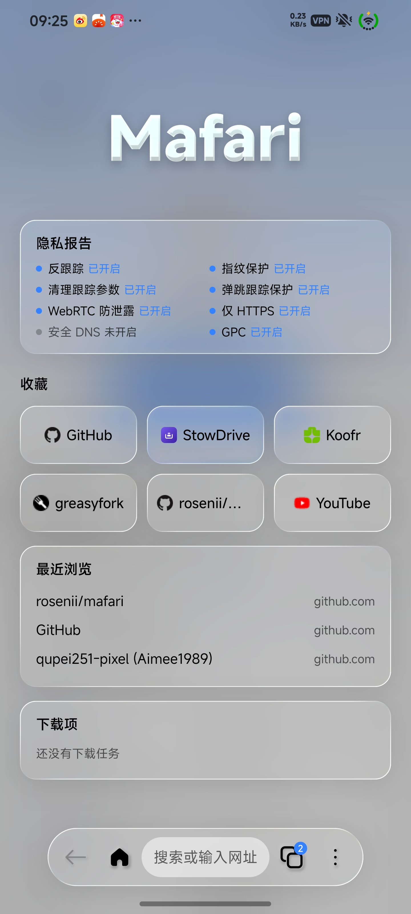
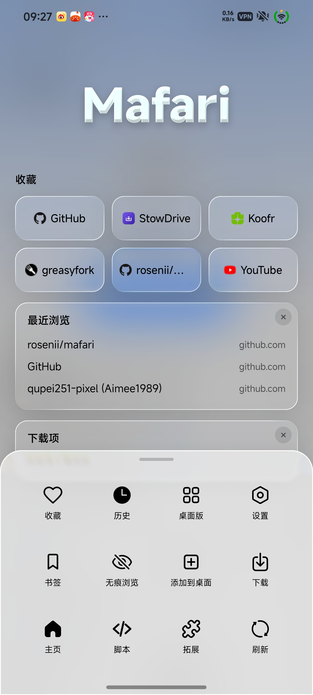

<div align="center">

# Mafari

**A good-looking, capable Android browser that supports extensions**

[简体中文](README.md) · **English** · [☕ Donate](#donate)

📢 [Telegram Channel](https://t.me/mafari_a) · 💬 [Telegram Group](https://t.me/Mafari_discuss) · 📦 [Download](https://github.com/rosenii/mafari/releases)

</div>

---

Mafari is an Android browser built on the **miuix** design language: clean, smooth, and still fully featured. Userscripts, ad blocking, reader mode, a password manager, and encrypted backups are all built in.

It comes in three editions — **lite, sync_lite, and gecko**. Pick lite for a small footprint, sync_lite if you also want cross-device sync, or gecko if you want the Firefox engine and Firefox extensions (including **Floccus bookmark sync**).

Free, ad-free, and maintained by an individual developer in their spare time.

<div align="center">

| Home | More panel | Settings |
| --- | --- | --- |
|  |  |  |

</div>

## Which edition should I choose?

| | **lite** | **sync_lite** | **gecko** |
| --- | --- | --- | --- |
| In a nutshell | Small and simple | lite + Firefox Sync | Dual engine, most complete |
| Rendering engine | System WebView | System WebView | System WebView + Firefox engine (GeckoView), switchable |
| APK size | Small | Small | Larger |
| Supported devices | arm64-v8a / armeabi-v7a / x86_64 | arm64 only | arm64 only |
| Userscripts | ✅ | ✅ | ✅ |
| Firefox extensions | — | — | ✅ |
| Floccus bookmark sync | — | — | ✅ |
| Firefox Account sync | — | ✅ | ✅ |
| Ad blocking | Built-in rule engine | Built-in rule engine | Built-in rules on WebView tabs; tracking protection or uBlock Origin on Gecko tabs |
| Encrypted backup to WebDAV / Git | ✅ | ✅ | ✅ |

All three editions share the same application ID, so you can install one over another and keep your data.

### lite: small and simple

No embedded browser engine — Mafari renders with the system WebView. The APK is small, web compatibility matches your system WebView, and it runs on nearly any device.

- **Ad blocking**: supports common subscription formats (Adblock Plus, uBlock, AdGuard, hosts). Import from a URL or file, with automatic updates daily, every 3 days, or weekly. Custom rules and a per-site allowlist are supported, and you can long-press any page element and choose "Mark as ad".
- **Fingerprint protection**: Canvas, WebGL, Audio, and Fonts can each be toggled separately, making it harder for sites to identify your device. See [docs/FINGERPRINT.md](docs/FINGERPRINT.md).
- Site permission management, HTTP / SOCKS5 proxy (with authentication), and Passkey support.

### sync_lite: small, with sync

lite plus **Firefox Account sync**. Sign in with the same Firefox Account and Mafari stays in step with Firefox on your computer and other phones:

- Syncs **bookmarks, history, open tabs, and passwords** using the official Firefox Sync protocol, with end-to-end encrypted account data.
- **Send the current page to another device**, and receive tabs sent from your other devices.
- Passwords sync both ways (including edits and deletions). Bookmarks and history are currently add-only: Firefox bookmarks appear in their own folder, and local bookmarks are pushed to "Mobile Bookmarks".

> arm64 only. If you already have sync_lite installed, update checks automatically move you to the newer sync_lite build.

### gecko: the full-featured dual-engine edition

Everything in lite, plus an embedded **GeckoView (Firefox Nightly)** engine. Switch between WebView and Gecko under **Settings → Advanced → Browser engine**. The engine is chosen per tab, so changing it only affects tabs you open afterwards. On unsupported devices, or if Gecko fails to start, Mafari falls back to WebView automatically. Firefox Account sync is included.

**Firefox extensions**
Search and install extensions from the Firefox add-on store (AMO) right inside the app, or import a local `.xpi`. You can enable / disable them, open their options pages, and get automatic update checks, with a confirmation dialog for every install and permission request.

**Floccus: cross-browser bookmark sync**
[Floccus](https://floccus.org) is an open-source bookmark sync extension that keeps bookmarks consistent across browsers and devices via Nextcloud, WebDAV, Git, and more. Mafari has dedicated support for it:

- When you install Floccus from the extensions page, Mafari adapts it automatically — it works right after installation, with no extra setup.
- Floccus syncs Mafari's own bookmarks: bookmarks organized on your phone show up on your computer, and new bookmarks from your computer appear in Mafari.
- On update checks, Mafari fetches the latest stable Floccus release from GitHub, adapts it again, and installs it over the old one.

> The adapted Floccus package no longer carries Mozilla's signature, so the engine must allow unsigned extensions (Nightly does by default). Mafari handles this during installation.

**Advanced privacy protection**
Enhanced Tracking Protection (off / standard / strict), tracking-parameter removal from URLs, bounce-tracking protection, periodic tracker-data cleanup, strong anti-fingerprinting, GPC / DNT, trimmed Referer, WebRTC IP-leak prevention, strict first-party isolation, HTTPS-only mode, secure DNS (DoH), ECH, and more — with one-tap restore to defaults.

**More**
- Userscripts work under Gecko too, sharing the same scripts and data as WebView. Script network, cookie, and notification capabilities are tightly restricted; see [docs/GECKO_GM.md](docs/GECKO_GM.md).
- Gecko's default font can follow the system font (including vendor theme fonts).
- Built-in USB remote debugging, `about:config`, and runtime logs for advanced users.

> On Gecko tabs, the built-in ad-blocking rules and "Mark as ad" don't apply — install uBlock Origin or use the built-in tracking protection instead. Site permissions are handled by Gecko itself. See [docs/GECKO.md](docs/GECKO.md) for the compatibility matrix.

## Features in all three editions

**Interface and browsing**
- A single floating bottom bar with soft-glass and liquid-glass effects. It makes room as you scroll down and returns at the top; swipe it sideways to collapse it into a round search button. Bar position can be set to "Top / Bottom / Always minimized".
- Multiple tabs, in either a text list or a card layout; the address bar can show the page title, the main domain, or the full domain.
- Home page sections (favorites, bookmark groups, privacy report, recent visits, downloads) can be shown, hidden, and reordered by dragging. The start page can be the default home, a new tab, or a specific URL.
- Tapping a bookmark group on the home page opens a small popup below its icon, so you can browse subgroups and bookmarks without leaving the page.
- Pull to refresh, find in page, translate, share, link long-press menu, and the other everyday essentials.

**Reader mode**
On article pages, a reader icon appears at the left of the address bar. Tap it and the page is reduced to the title, author, text, and images, following the app's light / dark theme. Tap again or press Back to return to the original page and scroll position.

**Download manager**
A built-in downloader with multi-threaded segmented downloads, resume, pause / continue, and retry on failure, with progress shown in the notification shade. On Xiaomi devices it also integrates with **Super Island**. Files are saved to `Download/mafari`.

**Userscripts**
Supports the `GM_*` APIs and script menu commands, with import from a URL or file. Opening a `.user.js` link prompts you to install it, and scripts can be updated manually or on a schedule.

**Passwords and autofill**
- Mafari offers to save or update a password after you sign in; next time, tap the login field and pick an account to fill. You can require authentication before filling.
- It can act as a system autofill service, filling login forms from Mafari's password vault on both WebView and Gecko pages.
- CSV import and export.

**Backup**
- Choose what to back up, then save it as a passphrase-encrypted local file or push it to **WebDAV / a Git repository**, optionally on a schedule.
- When restoring, pick exactly which items to bring back — switching phones is painless.

## Download and install

Get the APK from [Releases](https://github.com/rosenii/mafari/releases). **Android 13 or later** is required.

| APK | Edition |
| --- | --- |
| `Mafari-<version>-lite-<arch>.apk` | **lite**; choose by CPU architecture (arm64-v8a / armeabi-v7a / x86_64) — if unsure, pick arm64-v8a |
| `Mafari-<version>-sync_lite-arm64.apk` | **sync_lite**, arm64 only |
| `Mafari-<version>-gecko.apk` | **gecko**, arm64 only |

In **About → Version** you can choose an **update channel**; update checks then pick the matching package automatically.

## Community

- 📢 Updates: <https://t.me/mafari_a>
- 💬 Discussion: <https://t.me/Mafari_discuss>

Questions or suggestions are welcome in the group, or open an Issue on GitHub.

## Build it yourself

Requires JDK 17+ and the Android SDK. For lite:

```bash
./gradlew :app:assembleLiteArm64Debug
```

For full build instructions, build variants, the release pipeline, and code structure, see [docs/ARCHITECTURE.md](docs/ARCHITECTURE.md) (written in Chinese).

## License

Released under the [Apache License 2.0](LICENSE). The bundled `miuix/` subproject is also Apache-2.0; see [miuix/LICENSE](miuix/LICENSE).

Project page: <https://github.com/rosenii/mafari>

## Donate

Mafari is developed and maintained in the author's spare time. It is completely free and ad-free. If it helps you, consider buying the developer a coffee ☕ — it helps the project last longer.

<div align="center">


Scan with WeChat "Scan" (in the app: Settings / About → Donate, where you can save the QR code in one tap)

</div>

Can't donate? No problem — a ⭐ Star, a bug report, or a recommendation to a friend is just as valuable.
