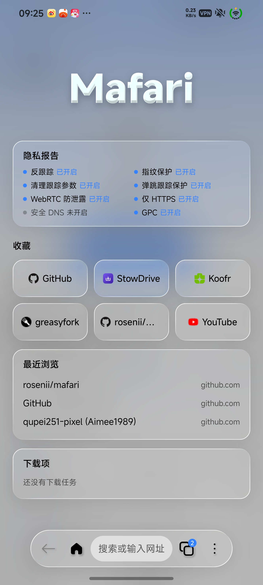
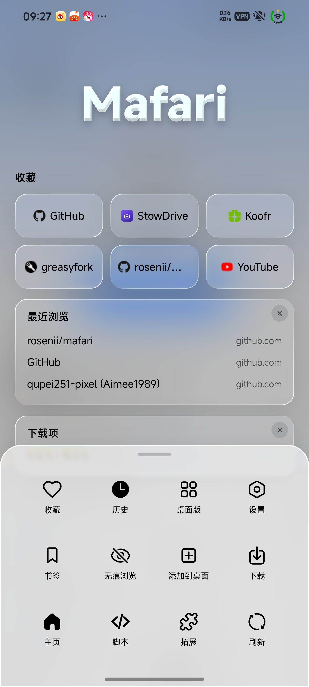
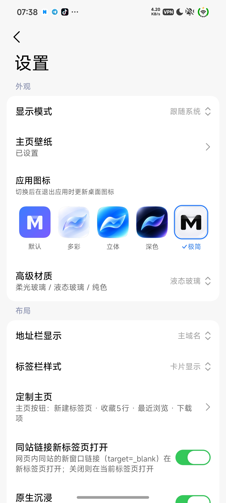

<div align="center">

# Mafari

[简体中文](README.md) · **English** · [☕ Donate](#donate)

📢 [Telegram Channel](https://t.me/mafari_a) · 💬 [Telegram Discussion](https://t.me/Mafari_discuss) · 📦 [Releases](https://github.com/rosenii/mafari/releases)

</div>

---

An Android browser built with **miuix** (Compose Multiplatform), available in two editions:

| | No-Engine Edition | Gecko Edition |
| --- | --- | --- |
| Rendering engine | System WebView — **no browser engine bundled**, small APK | Bundles **GeckoView (Nightly)** and keeps system WebView; switch between the two engines |
| Device requirement | Any supported Android device | Gecko engine is arm64-v8a only; other ABIs fall back to WebView automatically |
| Extensions | Userscripts | Userscripts + Firefox extensions (AMO / `.xpi`) |
| Ad blocking | Built-in rule engine | Works in WebView tabs; Gecko tabs use built-in tracking protection or uBlock Origin |
| APK | `Mafari-<version>-lite-<abi>.apk` in each Release (one per ABI: arm64-v8a / armeabi-v7a / x86_64) | `Mafari-<version>-gecko.apk` in each Release |
| Releases | Every Release carries both APKs: stable release on every tag, pre-release on every build of the `gecko` branch | Same |

## Community

- 📢 Channel: <https://t.me/mafari_a>
- 💬 Discussion group: <https://t.me/Mafari_discuss>

## UI

| Home | More panel | Settings |
| --- | --- | --- |
|  |  |  |

- A single minimal floating bottom bar with frosted-glass / liquid-glass effects
- Immersive full-screen browsing: the status-bar area is reserved at first, fills up as you scroll down and returns when you scroll back to the top, without blocking taps on elements at the top of the page
- Bottom-bar gestures: it hides after about 100px of downward scrolling and needs about 120px of upward scrolling to return; **swipe left/right** on the bar to shrink it into a round search button (tap or swipe again to expand); long-press the address bar to copy the URL

## Features shared by both editions

**Browsing**
- Multiple tabs (text list or card style), back / forward / reload, loading progress; the address bar can show the page title, the main domain, or the full domain
- Pull to refresh, find in page, translate, share, copy link, open in external browser, long-press link menu
- **Customize Home**: show / hide and drag to reorder home sections (favorites 1–5 rows, privacy report, recent, downloads). **Custom Home** lets you choose *Default home / New tab / Specified page* for what opens when you tap the home button, launch the app, or open a new tab
- Favorites / history / download manager / script manager; settings for appearance mode, wallpaper, blur effect, search engine, custom UA, proxy and update checks

**Downloads**
- Built-in downloader (not the system one): writes to cache first, then moves into `/sdcard/Download/mafari`
- Multi-threaded segmented download (when the server supports Range), resume, pause / continue, retry
- Foreground service with progress notification; integrates Xiaomi **Super Island** (`miui.focus.param`, shown only when a download starts)

**Userscripts**
- Built-in userscript runtime with the `GM_*` APIs, script menu commands, import from URL / file, automatic detection of `.user.js` links with an import prompt, one-tap and scheduled updates

---

## No-Engine Edition (System WebView)

No browser engine is bundled. Pages are rendered by the system WebView, so the APK is small and web compatibility matches your system WebView.

### Ad blocking (Settings → Advanced → Ad blocking)

- **Network blocking**: sub-resource requests are filtered in `shouldInterceptRequest` (`||domain^`, wildcards, `@@` exceptions, `$third-party / $domain= / resource types / $important`)
- **Element hiding**: `##selector`, per-site rules, `~site` exclusions, `#@#` exceptions; injected at document-start into all frames
- **Subscriptions**: import from URL or local file; Adblock Plus, uBlock, AdGuard and hosts formats; enable / disable, manual or automatic updates (daily / every 3 days / weekly)
- **Custom rules** and a **site allowlist**; long-pressing a page element and choosing "Mark as ad" writes a custom rule
- Not supported: regex rules, `$redirect / $removeparam / $csp / $replace`, `#?#` extended selectors, `+js()` (skipped when parsing)
- Subscriptions are third-party content; element-hiding selectors are validated before injection and selectors containing `{ } ;` are rejected

### Fingerprint protection (Settings → Privacy & security → Fingerprint protection)

Four independent switches:

- **Canvas**: `toDataURL / toBlob / getImageData / OffscreenCanvas` reads add ±1 random pixel noise; the canvas itself is unchanged
- **WebGL**: spoofs `UNMASKED_VENDOR / RENDERER`, adds noise to `readPixels` and WebGL canvas exports
- **Audio**: adds roughly -100 dB noise to `AudioBuffer` (including OfflineAudioContext output) and `AnalyserNode`
- **Fonts**: perturbs `measureText`, probe-element sizes with inline `font-family`, `FontFace local()` loading and `queryLocalFonts`, so installed fonts cannot be enumerated

A separate "protection exempt sites" list is also available: scripts are registered per origin at document-start with the configuration inlined natively, so pages cannot query it; only the main frame and same-origin iframes are protected; APIs are not disabled — fingerprints are "farbled" only when read. See [docs/FINGERPRINT.md](docs/FINGERPRINT.md) for the security boundary and fallbacks.

### Other
- Site permission management (camera / microphone / location / notifications / clipboard / media sound / page redirects), proxy (HTTP / SOCKS5 with authentication), Passkey

---

## Gecko Edition (dual engine)

On top of the No-Engine Edition, it bundles **GeckoView Nightly** (arm64-v8a only). Switch between **WebView and Gecko** under Settings → Advanced → Browser engine. The engine is chosen **per tab**: a change only affects tabs opened afterwards. On non-arm64-v8a devices, or if Gecko fails to start, it falls back to WebView automatically. See [docs/GECKO.md](docs/GECKO.md) for the feature matrix and code layout (in Chinese).

### Gecko-only features

- **Firefox extensions** (Settings → Advanced → Extensions): search and install from the Firefox add-on store (AMO), or import from a link / local `.xpi`; enable / disable, options page, check for updates, uninstall; scheduled automatic update checks; install / update / optional-permission prompts are shown with translated permission names
- **Userscripts**: a built-in WebExtension runtime that shares scripts and GM values with the WebView runtime. Security model: pages cannot reach the channel (private MessageChannel plus a per-script capability token, revoked as soon as a script is disabled or deleted); `GM_xmlhttpRequest` is limited to hosts allowed by `@connect`, redirects are checked hop by hop, and request / response sizes are capped; `GM_cookie` is limited to same-site or hosts explicitly listed in `@connect`; private tabs neither proxy requests nor read or write cookies; opening tabs, notifications, downloads and clipboard access are rate-limited. See [docs/GECKO_GM.md](docs/GECKO_GM.md)
- **Gecko advanced protection** (Settings → Advanced): Enhanced Tracking Protection (off / standard / strict), URL tracking-parameter stripping, bounce-tracking protection, periodic tracker-data purge, fingerprinting protection and resist-fingerprinting, GPC / DNT, trimmed Referer, WebRTC IP-leak protection, strict first-party isolation, HTTPS-only, secure DNS (DoH), ECH, disabling prefetch / preconnect, disabling WebGL, with one-tap reset to defaults
- **Default font follows the system font** (Settings → Advanced → Gecko debug): detects the font Android actually uses (including vendor theme fonts) and makes Gecko's default font follow it; fonts a page specifies itself are untouched; restart the app after changing the system font
- **System autofill**: username / password fields in Gecko tabs can bring up the system autofill service (e.g. Google Password Manager)
- **Gecko debug**: USB remote debugging, `about:config`, rendering info, runtime log, and more

### Differences from the No-Engine Edition

- In Gecko tabs the built-in ad-block rules, "Mark as ad" and page enhancements do not apply; install uBlock Origin or use the built-in Enhanced Tracking Protection instead
- Fingerprint protection in Gecko tabs comes from Gecko itself (the four fine-grained switches do not apply)
- Notifications, clipboard access and media sound permissions are handled by Gecko's own permission system

---

## Build & release

### Local build

```bash
# Requires JDK 17+ (21 recommended) and the Android SDK (platforms;android-37.0, build-tools;36.0.0)
# Root project uses Gradle 9.9.0; miuix sources live in ./miuix and are pulled in via includeBuild
# Variants = engine (gecko / lite) x ABI (arm64 / arm32 / x64); Gecko only makes sense on arm64, so name the tasks explicitly instead of running `assemble`
./gradlew :app:assembleLiteArm64Debug     # No-Engine Edition, arm64 → app/build/outputs/apk/liteArm64/debug/
./gradlew :app:assembleGeckoArm64Debug    # Gecko Edition (arm64 only) → app/build/outputs/apk/geckoArm64/debug/
./gradlew :app:assembleLiteArm64Release :app:assembleLiteArm32Release :app:assembleLiteX64Release :app:assembleGeckoArm64Release   # release builds (needs the signing env vars below)
```

The two editions are two product flavors of the same sources (`app/build.gradle.kts`): in `lite`, GeckoView is `compileOnly` (not packaged), `BuildConfig.GECKO_ENABLED` is `false`, and Gecko-only assets (`src/gecko/assets`) are excluded. Shared code that can reach a Gecko class must first check `EngineSupport.GECKO_BUNDLED` / `EngineSupport.geckoAvailable()`.

The Gecko Edition pulls GeckoView Nightly from Mozilla Maven. Nightly Java APIs change from time to time, so pinning `geckoViewVersion=<version>` in `gradle.properties` is recommended. Both editions share one application ID by default (they upgrade over each other); pass `-PgeckoAppIdSuffix=.gecko` to install them side by side.

In-app update checks pick the asset matching the current flavor (`-gecko.apk` / `-lite-<abi>.apk`, the latter by the device ABI), so one edition never upgrades into the other. Keep `AboutScreen.kt` `pickApkUrl` in sync if you rename the APKs.

### Automated releases with GitHub Actions

Pushing a tag builds and publishes a Release; every build of the `gecko` branch publishes a pre-release. Each run builds both editions (`Mafari-<label>-gecko.apk`, plus `Mafari-<label>-lite-<abi>.apk` ×3) plus `SHA256SUMS.txt`:

```bash
git tag v3.3.0 && git push origin v3.3.0
```

Optional signing secrets (a debug build is produced without them):

| Secret | Content |
| --- | --- |
| `KEYSTORE_BASE64` | `base64 -w0 your.jks` |
| `STORE_PASSWORD` | keystore password |
| `KEY_ALIAS` | key alias |
| `KEY_PASSWORD` | key password |
| `TELEGRAM_BOT_TOKEN` | Optional: Telegram bot token (the bot must be a channel admin); when set, stable releases and pre-releases are also pushed to the channel |
| `TELEGRAM_CHAT_ID` | Optional: channel ID, defaults to `@mafari_a` |

## License

Released under the [Apache License 2.0](LICENSE). The bundled `miuix/` sub-project is also Apache-2.0, see [miuix/LICENSE](miuix/LICENSE).

## Repository

<https://github.com/rosenii/mafari>

## Donate

Mafari is built and maintained in spare time, and is free with no ads. If it is useful to you, consider buying the developer a coffee ☕ — it helps keep the project going.

<div align="center">


Scan with WeChat (Scan → pick from album). In the app: Settings / About → Donate, where the QR code can be saved in one tap.

</div>

Can't donate? A ⭐ Star, a bug report or telling a friend helps just as much.

