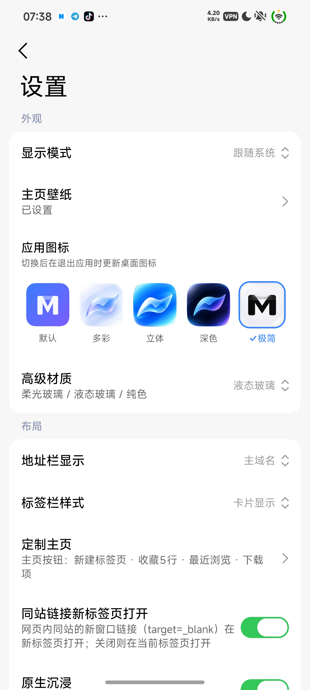

# Mafari

**A good-looking, capable Android browser that supports extensions**

[简体中文](README.md) · **English** · [☕ Donate](#donate) · [License](#copyright-and-license)

📢 [Telegram Channel](https://t.me/mafari_a) · 💬 [Telegram Group](https://t.me/Mafari_discuss) · 📦 [Download](https://github.com/rosenii/mafari/releases)

**source-available project**

---

Mafari is an Android browser built on the **miuix** design language: clean, smooth, and still fully featured. Userscripts, ad blocking, reader mode, a password manager, and encrypted backups are all built in — and the system WebView engine can run browser extensions too (experimental).

It comes in three editions — **lite, sync_lite, and gecko**. Pick lite for a small footprint, sync_lite if you also want cross-device sync, or gecko if you want the Firefox engine and native Firefox extensions (including **Floccus bookmark sync**). WebView tabs in all three editions can install extensions (experimental, see below).

Free, ad-free, and maintained by an individual developer in their spare time.

| Home | More panel | Settings |
| --- | --- | --- |
|  |  |  |

## Which edition should I choose?

| | **lite** | **sync_lite** | **gecko** |
| --- | --- | --- | --- |
| In a nutshell | Small and simple | lite + Firefox Sync | Dual engine, most complete |
| Rendering engine | System WebView | System WebView | System WebView + Firefox engine (GeckoView), switchable |
| APK size | Small | Small | Larger |
| Supported devices | arm64-v8a / armeabi-v7a / x86_64 | arm64 only | arm64 only |
| Userscripts | ✅ | ✅ | ✅ |
| WebView extensions (experimental) | ✅ | ✅ | ✅ (WebView tabs) |
| Firefox extensions (native Gecko) | — | — | ✅ |
| Floccus bookmark sync | — | — | ✅ |
| Firefox Account sync | — | ✅ | ✅ |
| Ad blocking | Built-in rule engine | Built-in rule engine | Built-in rules on WebView tabs; tracking protection or uBlock Origin on Gecko tabs |
| Encrypted backup to WebDAV / Git | ✅ | ✅ | ✅ |

All three editions share the same application ID, so you can install one over another and keep your data.

### lite: small and simple

No embedded browser engine — Mafari renders with the system WebView. The APK is small, web compatibility matches your system WebView, and it runs on nearly any device.

- **Ad blocking**: supports common subscription formats (Adblock Plus, uBlock, AdGuard, hosts). Import from a URL or file, with automatic updates daily, every 3 days, or weekly. Custom rules and a per-site allowlist are supported, and you can long-press any page element and choose "Mark as ad".
- **Fingerprint protection**: Canvas, WebGL, Audio, and Fonts can each be toggled separately, making it harder for sites to identify your device. See [docs/FINGERPRINT.md](docs/FINGERPRINT.md).
- Site permission management, HTTP / SOCKS5 proxy (with authentication), and Passkey support.

### sync_lite: small, with sync

lite plus **Firefox Account sync**. Sign in with the same Firefox Account and Mafari stays in step with Firefox on your computer and other phones:

- Syncs **bookmarks, history, open tabs, and passwords** using the official Firefox Sync protocol, with end-to-end encrypted account data.
- **Send the current page to another device**, and receive tabs sent from your other devices.
- Passwords sync both ways (including edits and deletions). Bookmarks and history are currently add-only: Firefox bookmarks appear in their own folder, and local bookmarks are pushed to "Mobile Bookmarks".

> arm64 only. If you already have sync_lite installed, update checks automatically move you to the newer sync_lite build.

### gecko: the full-featured dual-engine edition

Everything in lite, plus an embedded **GeckoView (Firefox Nightly)** engine. Switch between WebView and Gecko under **Settings → Advanced → Browser engine**. The engine is chosen per tab, so changing it only affects tabs you open afterwards. On unsupported devices, or if Gecko fails to start, Mafari falls back to WebView automatically. Firefox Account sync is included.

**Firefox extensions**
Search and install extensions from the Firefox add-on store (AMO) right inside the app, or import a local `.xpi`. You can enable / disable them, open their options pages, and get automatic update checks, with a confirmation dialog for every install and permission request.

**Floccus: cross-browser bookmark sync**
[Floccus](https://floccus.org) is an open-source bookmark sync extension that keeps bookmarks consistent across browsers and devices via Nextcloud, WebDAV, Git, and more. Mafari has dedicated support for it:

- When you install Floccus from the extensions page, Mafari adapts it automatically — it works right after installation, with no extra setup.
- Floccus syncs Mafari's own bookmarks: bookmarks organized on your phone show up on your computer, and new bookmarks from your computer appear in Mafari.
- On update checks, Mafari fetches the latest stable Floccus release from GitHub, adapts it again, and installs it over the old one.

> The adapted Floccus package no longer carries Mozilla's signature, so the engine must allow unsigned extensions (Nightly does by default). Mafari handles this during installation.

**Advanced privacy protection**
Enhanced Tracking Protection (off / standard / strict), tracking-parameter removal from URLs, bounce-tracking protection, periodic tracker-data cleanup, strong anti-fingerprinting, GPC / DNT, trimmed Referer, WebRTC IP-leak prevention, strict first-party isolation, HTTPS-only mode, secure DNS (DoH), ECH, and more — with one-tap restore to defaults.

**More**
- Userscripts work under Gecko too, sharing the same scripts and data as WebView. Script network, cookie, and notification capabilities are tightly restricted; see [docs/GECKO_GM.md](docs/GECKO_GM.md).
- Gecko's default font can follow the system font (including vendor theme fonts).
- Built-in USB remote debugging, `about:config`, and runtime logs for advanced users.

> On Gecko tabs, the built-in ad-blocking rules and "Mark as ad" don't apply — install uBlock Origin or use the built-in tracking protection instead. Site permissions are handled by Gecko itself. See [docs/GECKO.md](docs/GECKO.md) for the compatibility matrix.

## Features in all three editions

**Interface and browsing**
- On web pages, the status bar background uses the same **miuix progressive blur** as sub-page top bars (strongest at the top, fading downward, sampling the stretched page top edge). It shows while the page is in its initial state and fades out once you scroll into immersive mode; it applies to the default floating bar, the floating three-segment bar, and the bottom-fixed bar.
- When the floating three-segment bar detects a bottom bar or input box on the page (chat composers, comment boxes, checkout bars), it sinks to the bottom and reserves a row. That row's background is now a progressive blur too (strongest at the bottom edge, fading upward), sampling the stretched page bottom edge.
- A single floating bottom bar with four selectable materials under "Advanced material": soft glass (refraction and edge highlights), frosted (no refraction, steadier and lighter), liquid glass, or solid color. It makes room as you scroll down and returns at the top; swipe it sideways to collapse it into a round search button. Bar style can be set to "Top / Bottom / Always minimized / Fixed / Floating three-segment".
- Multiple tabs, in either a text list or a card layout; the address bar can show the page title, the main domain, or the full domain.
- Home page sections (favorites, bookmark groups, privacy report, recent visits, downloads) can be shown, hidden, and reordered by dragging. The start page can be the default home, a new tab, or a specific URL.
- Tapping a bookmark group on the home page opens a small popup below its icon, so you can browse subgroups and bookmarks without leaving the page.
- Pull to refresh, find in page, translate, share, link long-press menu, and the other everyday essentials.
- While you type a URL, the left end of the address bar shows the current search engine icon; tap it to switch engines quickly. You can add custom engines at the end of the list (use `%s` for the query in the URL) and delete them later.
- "Add to home screen" turns a page into a home-screen icon that opens as a standalone window without the bottom bar (a lightweight app). On Gecko tabs, a page with a Web App Manifest (PWA) takes its name, icon, scope, and theme color from the manifest. "Scan" reads QR codes and barcodes (recognition is built in and does not need Google Play services).
- The home page supports a wallpaper (optionally blurred), and there are 6 launcher icons to choose from.
- Private (incognito) tabs use a separate WebView Profile: cookies, cache, local storage, and site permissions are isolated from regular tabs, and the whole profile is deleted when it closes.

**External links and default browser**
- Mafari can be your system default browser: it asks on first launch, and you can set it any time in **Settings → Set as default browser**.
- **Settings → How external links open** has three options:
  - **In the app**: opens the Mafari main screen.
  - **Custom tab**: opens a lightweight web window on top of the calling app; Back returns to that app, and one tap opens the page in Mafari instead. Mafari also provides a Custom Tabs service, so apps that use Custom Tabs recognize it as a browser that supports them.
  - **Another browser**: shows a chooser that excludes Mafari itself.
- Home-screen shortcuts always open in the app and ignore this setting.

**WebView extensions (experimental)**
The system WebView can run extensions too: Mafari ships its own WebExtensions adapter that maps `browser.*` / `chrome.*` onto WebView, and both MV2 and MV3 extensions can be tried. It works on WebView tabs in lite, sync_lite, and gecko; Gecko tabs keep using native Firefox extensions.

- **Install and manage**: in **Settings → Extensions**, search the Firefox add-on store (AMO) or import a store page link, a `.zip` / `.crx` / `.xpi` direct link, or a local package. A permission dialog is shown before install and grant; enable / disable, uninstall, options pages, and automatic update checks are supported. The "Page enhancements" master switch stops all userscripts, ad blocking, and extensions at once — nothing is loaded at cold start while it is off.
- **Quick menu**: More → Extensions opens the running list with per-extension toggles; extensions that declare a popup open it inside the sheet, and a long-press goes to the extension manager.
- **Isolation**: each extension gets its own WebView Profile, so its storage is invisible to tabs and other extensions; where the system WebView supports it, content scripts run in a separate isolated world. Incognito tabs do not run extensions.
- **No cold-start cost**: extensions load after the first page finishes, and background pages are started staggered.
- **Adapted APIs** (permission-checked; anything not implemented rejects with `UNSUPPORTED` instead of pretending to succeed): `runtime` messaging / Ports / `getContexts`, `storage`, `alarms`, `permissions`, `tabs`, `scripting` and dynamic content scripts, `webNavigation`, `webRequest` (including `onBeforeRequest` cancel / redirect), `declarativeNetRequest` dynamic rules, `userScripts`, `bookmarks`, `cookies`, `downloads`, `history`, `contextMenus`, `notifications`, `action` / `browserAction`, `offscreen`, `i18n`, plus Mafari-specific `clipboard` and `mafari.userscripts`.
- **Known limits**: single window; `scripting` / `webNavigation` handle the main frame only; the MV3 service worker is a hidden-page emulation without real sleep / wake; `storage.sync` is local only; header rewriting in `webRequest` is limited by WebView.

> Userscripts are built in — please don't install Tampermonkey-style extensions. Details: [docs/WEBEXT_WEBVIEW.md](docs/WEBEXT_WEBVIEW.md), [docs/MAFARI_WEBEXT_API.md](docs/MAFARI_WEBEXT_API.md), and the [compatibility matrix](WEBEXT_API_COMPATIBILITY_MATRIX_UPDATED.md).

**Reader mode**
On article pages, a reader icon appears at the left of the address bar. Tap it and the page is reduced to the title, author, text, and images, following the app's light / dark theme. Tap again or press Back to return to the original page and scroll position.

**Download manager**
A built-in downloader with multi-threaded segmented downloads, resume, pause / continue, and retry on failure, with progress shown in the notification shade. On Xiaomi devices it also integrates with **Super Island**. Files are saved to `Download/mafari`.

**Userscripts**
Supports the `GM_*` APIs and script menu commands, with import from a URL or file. Opening a `.user.js` link prompts you to install it, and scripts can be updated manually or on a schedule.

**Passwords and autofill**
- Mafari offers to save or update a password after you sign in; next time, tap the login field and pick an account to fill. You can require authentication before filling.
- It can act as a system autofill service, filling login forms from Mafari's password vault on both WebView and Gecko pages.
- CSV import and export.

**Backup**
- Choose what to back up, then save it as a passphrase-encrypted local file or push it to **WebDAV / a Git repository**, optionally on a schedule.
- When restoring, pick exactly which items to bring back — switching phones is painless.
- Backup files are protected by your passphrase (Argon2id key derivation) and use post-quantum hybrid encryption (ML-KEM + X25519 + AES-256-GCM). Data on the device is encrypted too: the history database uses SQLCipher (whole-database AES-256), and bookmarks, passwords, and similar records are encrypted per entry.

## Download and install

Get the APK from [Releases](https://github.com/rosenii/mafari/releases). **Android 13 or later** is required.

| APK | Edition |
| --- | --- |
| `Mafari-<version>-lite-<arch>.apk` | **lite**; choose by CPU architecture (arm64-v8a / armeabi-v7a / x86_64) — if unsure, pick arm64-v8a |
| `Mafari-<version>-sync_lite-arm64.apk` | **sync_lite**, arm64 only |
| `Mafari-<version>-gecko.apk` | **gecko**, arm64 only |

In **About → Version** you can choose an **update channel**; update checks then pick the matching package automatically. Releases include `SHA256SUMS.txt`; after an in-app update downloads, its SHA-256 is verified, and when the official digest is available a mismatching package is discarded.

## Community

- 📢 Updates: <https://t.me/mafari_a>
- 💬 Discussion: <https://t.me/Mafari_discuss>

Questions or suggestions are welcome in the group, or open an Issue on GitHub.

## Donate

Mafari is developed and maintained in the author's spare time. It is completely free and ad-free. If it helps you, consider buying the developer a coffee ☕ — it helps the project last longer.

Scan with WeChat "Scan" (in the app: Settings / About → Donate, where you can save the QR code in one tap)

Can't donate? No problem — a ⭐ Star, a bug report, or a recommendation to a friend is just as valuable.

## Localization

Settings → Appearance → first row "Language": follow system / English / 简体中文 / 繁體中文 (the app restarts automatically after switching). The first onboarding screen has a language picker too.

- UI strings in the source use Simplified Chinese as the key: `tr("设置")`; with arguments use `{0}` `{1}`: `tr("共 {0} 项", n)` (`i18n/I18n.kt`).
- English: `app/src/main/assets/i18n/en.tsv` (`Chinese<TAB>English`; `\n` `\t` `\\` are escapes).
- Traditional Chinese: converted at runtime from `zh-TW-phrases.tsv` (Taiwan wording) plus `s2t.txt` (character-by-character table); add a line to the phrases file for any awkward word.
- A missing translation falls back to the Simplified Chinese source text instead of crashing. For new strings, write `tr("…")` in code and add one line to `en.tsv`.
- System-level strings (app name, autofill service name) live in `res/values*/strings.xml` and follow the system language.

## WebExtension adapter docs

The WebView extension adapter (experimental) is documented in [`docs/WEBEXT_WEBVIEW.md`](docs/WEBEXT_WEBVIEW.md). Mafari-specific APIs (clipboard, native userscript bridge, partial `webRequestBlocking`) are in [`docs/WEBEXT_MAFARI_APIS.md`](docs/WEBEXT_MAFARI_APIS.md) and [`docs/MAFARI_WEBEXT_API.md`](docs/MAFARI_WEBEXT_API.md); dynamic DNR rules and the `userScripts` subset are in [`docs/WEBEXT_DNR_USERSCRIPTS.md`](docs/WEBEXT_DNR_USERSCRIPTS.md). The compatibility matrix is in [`WEBEXT_API_COMPATIBILITY_MATRIX_UPDATED.md`](WEBEXT_API_COMPATIBILITY_MATRIX_UPDATED.md).

## Copyright and license

Copyright © 2026 rosenii. All rights reserved.

Mafari is **source-available software, not open-source software**. The full terms are in [`licence`](licence) at the repository root (the Chinese text prevails if the two languages conflict); this is only a summary:

| You may | You may not |
| --- | --- |
| View and read the source code | Publish the software or a modified version as an executable, installer, app package, or deployed service (free or paid) |
| Use it for personal study, research, or technical evaluation | Use it for any commercial purpose (selling, charging, ad revenue, part of a paid product) |
| Modify, run, and test it locally or in a non-public environment you control | Submit it to any app store, distribution platform, or package manager |
| Fork it to an account you control | Remove or alter copyright notices, the license, or source attribution |
| Publicly distribute your modified **source**, provided you keep the license and copyright notices, credit [rosenii/mafari](https://github.com/rosenii/mafari), state that you modified it, and do not relicense it under an open-source license | Rename it or swap the icon and present it as your own work |

Installers are published only on this repository's [Releases](https://github.com/rosenii/mafari/releases) page; please do not download them from anywhere else.

Mafari uses third-party components such as miuix, GeckoView, and Kyant's Backdrop. They are **not** covered by the license above and remain under their own licenses. See [`THIRD_PARTY_NOTICES.md`](THIRD_PARTY_NOTICES.md) and [`third-party-licenses/`](third-party-licenses/) for the full list and license texts.

For permissions beyond these terms, contact the author via a GitHub Issue or Telegram.
